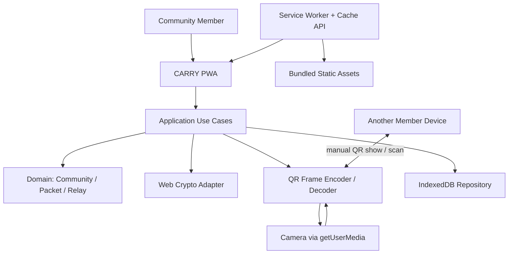
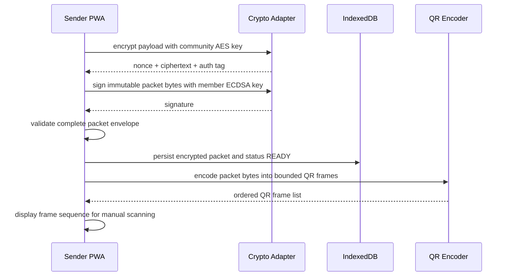
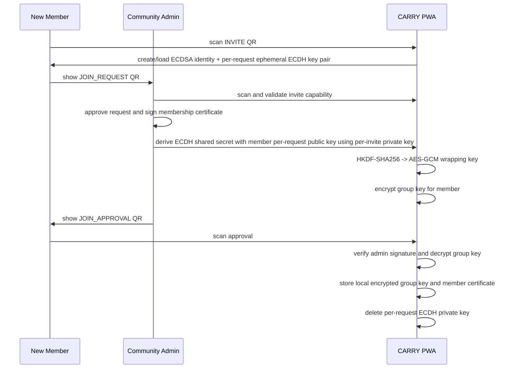

# CARRY — Technical Architecture

**Architecture style:** Local-first modular PWA  
**Backend:** None for MVP  
**Primary runtime:** Modern mobile browser / installed PWA  
**Transport:** QR frames displayed and scanned by people  
**Persistence:** IndexedDB (Dexie wrapper)

## 1. Architecture goals

1. Run all core product flows without a network after first install/cache.
2. Avoid paid APIs, hosted databases, backend servers, account providers, and telemetry vendors.
3. Keep domain logic independent from React and browser APIs.
4. Make packet encoding, cryptography, QR framing, and local persistence testable as separate modules.
5. Avoid claims of automatic mesh networking; QR relay is a deliberate human action.
6. Keep security-sensitive code small, typed, and covered by tests.

## 2. Recommended stack

| Layer | Choice | Why |
|---|---|---|
| App/build | Vite + React + TypeScript | Simple static PWA build, good local development |
| Styling | Tailwind CSS + local CSS tokens | Consistent responsive UI without runtime CDN |
| Routing | React Router or equivalent small SPA router | Local routes and deep-link fallback |
| PWA | `vite-plugin-pwa` / Workbox | Precache app shell and manage service worker |
| Local DB | Dexie + IndexedDB | Typed local stores and transactions |
| Validation | Zod | Runtime validation for scanned untrusted data |
| QR generation | `qrcode` | Locally bundled QR image generation |
| QR scanning | `@zxing/browser` | Browser camera/image scanning fallback |
| Cryptography | Web Crypto API | AES-GCM, ECDH, HKDF, ECDSA |
| Unit tests | Vitest | Pure protocol and domain tests |
| Browser tests | Playwright | PWA flow and deterministic UI tests |
| Icons | Lucide React | Lightweight, consistent line icons |

All runtime dependencies must be bundled in the build. No CDN imports, remote fonts, external analytics, or runtime API calls.

## 3. System context



There is no server component in the MVP. Two devices do not discover each other automatically. A person displays a QR frame and another person scans it.

## 4. Logical layers

### Presentation

- Home and community list.
- Community detail and member list.
- Create invitation, join request, approval.
- Message composer and inbox.
- QR show/scan and multi-frame progress.
- Relay queue and acknowledgement states.
- Offline readiness and device-local settings.

### Application layer

Use cases orchestrate domain and adapters:

- `CreateCommunity`
- `CreateInvite`
- `CreateJoinRequest`
- `ApproveJoinRequest`
- `AcceptJoinApproval`
- `ComposeMessage`
- `BuildQrTransfer`
- `AcceptQrFrame`
- `FinalizeQrTransfer`
- `RelayPacket`
- `CreateAcknowledgement`
- `AcceptAcknowledgement`

### Domain layer

- Community and member models.
- Membership certificate validation.
- Packet envelope and packet status.
- Frame and transfer rules.
- TTL, max hop hint, deduplication rules.
- Protocol error types.
- No DOM, IndexedDB, React, or camera references.

### Infrastructure layer

- `CryptoAdapter`: Web Crypto operations and key vault.
- `CommunityRepository`: Dexie/IndexedDB.
- `PacketRepository`: encrypted envelopes and status.
- `TransferRepository`: partial frame reassembly state.
- `QrEncoder`: QR generation.
- `QrScanner`: ZXing camera and image scanning.
- `PwaReadiness`: service-worker and precache status.
- `Clock`: injectable clock for expiry tests.

## 5. Data flow — message sending



## 6. Data flow — join approval



## 7. Cryptography design

- Group messages: AES-256-GCM.
- Per-message nonce: 96-bit random value from `crypto.getRandomValues`; never reuse a nonce with the same group key.
- Key delivery: unique ephemeral ECDH P-256 pairs per invite and join request, then HKDF-SHA-256 to derive a one-time AES-GCM wrapping key.
- Device identity: ECDSA P-256 with SHA-256.
- Member certificate: signed by community administrator; includes community ID, member ID, display name, public signing key, role, issue time, and key epoch.
- Message signature: covers immutable packet header, nonce, ciphertext, and certificate hash.
- AES-GCM Additional Authenticated Data (AAD): deterministic encoding of protocol version, packet type, community ID, packet ID, key epoch, sender ID, created time, expiry, and max hops.
- Store private CryptoKeys as non-extractable where possible. Store CryptoKey objects in IndexedDB; store group key bytes only after wrapping with a device-local vault key.

The cryptography is built from browser primitives. This is not a substitute for an external cryptographic audit. Kiro must not invent custom ciphers or custom signature algorithms.

## 8. Offline/PWA architecture

- PWA manifest with standalone display mode, name, icons, theme colors, and start URL.
- Service worker precaches HTML, JS, CSS, icons, QR library, scanner library, and local font assets if any.
- Cache-first strategy for versioned app-shell assets.
- No network-first request is required for core routes or data.
- A visible offline-readiness test checks `navigator.serviceWorker.controller`, expected cache keys, and required assets.
- IndexedDB stores all community and packet data locally.
- A schema migration must not silently delete communities or keys.

**Important:** service workers and camera access require a secure context. Use HTTPS on physical phones; browsers treat localhost as secure for development. The PWA must be loaded and cached once before Airplane Mode.

## 9. QR capture strategy

- Generate QR locally with a bundled QR library.
- Use `@zxing/browser` as the primary cross-browser scanning implementation.
- Native `BarcodeDetector` may be used only as a feature-detected optional fast path because it is not available across all major browsers.
- Camera access is requested only after explicit user action.
- Provide a manual image-upload scan fallback for troubleshooting and tests.
- Stop camera tracks when scanner closes or route changes.

## 10. Repository structure

```text
carry/
├── .kiro/
│   ├── steering/
│   └── specs/
├── assets/
├── public/
│   ├── icons/
│   ├── manifest.webmanifest
│   └── offline.html
├── src/
│   ├── app/
│   │   ├── routes/
│   │   ├── providers/
│   │   └── styles/
│   ├── components/
│   ├── features/
│   │   ├── communities/
│   │   ├── membership/
│   │   ├── messages/
│   │   ├── packet-transfer/
│   │   └── relay/
│   ├── domain/
│   │   ├── community/
│   │   ├── identity/
│   │   ├── packet/
│   │   └── transfer/
│   ├── application/
│   │   └── use-cases/
│   ├── infrastructure/
│   │   ├── crypto/
│   │   ├── db/
│   │   ├── pwa/
│   │   └── qr/
│   └── test/
├── docs/
└── package.json
```

## 11. Failure handling

- Unsupported protocol version → reject with `UNSUPPORTED_VERSION`.
- Unknown community → reject with `UNKNOWN_COMMUNITY`.
- Missing frames → persist partial transfer and prompt to scan remaining frames.
- Conflicting chunk or digest mismatch → discard/mark transfer invalid.
- Invalid signature/certificate → reject; never show message content.
- AES-GCM authentication failure → reject; never show message content.
- Expired packet → reject or archive as expired; do not relay.
- Duplicate packet → do not create another inbox entry; retain idempotent status.
- Camera permission denied → explain and offer image upload/manual test flow.
- IndexedDB unavailable/quota error → show explicit local storage error and block operations that could lose data.

## 12. Deployment and zero-cost plan

- Develop locally with Vite.
- Build a static bundle.
- Deploy to a static HTTPS host with a free tier, after checking current terms and limits.
- No database server or API hosting.
- The exact host is not a product dependency; static files must work from any valid HTTPS origin with correct SPA fallback and service-worker scope.
- For the offline demo, install/cache on each phone before switching connectivity off.

## 13. Architecture decision records

### ADR-001: PWA instead of native app

Chosen because it avoids app-store distribution and supports local storage, camera, installability, and offline shell. Camera and service-worker features still require a secure context on real devices.

### ADR-002: QR manual relay instead of automatic mesh

Chosen for zero infrastructure and highly visible demo behavior. Trade-off: manual human handoff is slower and does not guarantee delivery.

### ADR-003: no backend for MVP

Chosen to preserve zero-cost offline behavior. Trade-off: no centralized recovery, synchronization, or instant revocation.

### ADR-004: short text packets only

Chosen to keep QR transfer reliable. File/photo transfer is deferred.
